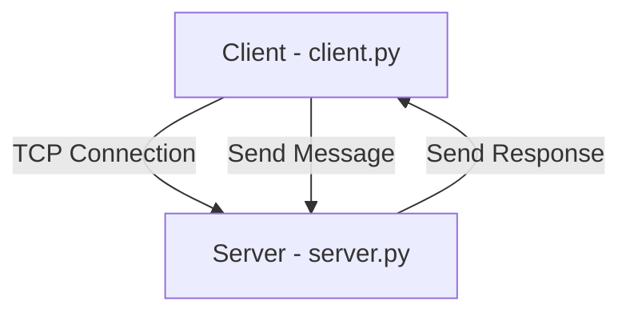

# Client_Server-Model
A beginner-friendly Computer Networking project built using Python socket programming. This project demonstrates how a client and a server communicate using the TCP protocol, exchange messages, and establish a connection through an IP address and port number.

## 📌 Project Overview

The Client-Server Model is a networking architecture in which a client requests a service or information from a server. The server processes the request and sends a response back to the client.

In this project:
- `server.py` creates a TCP server and waits for client connections.
- `client.py` connects to the server and sends a message.
- The server receives the message and sends a response.
- Both sides close their sockets after communication.

## 🎯 Objectives

- Understand client-server architecture.
- Learn Python socket programming.
- Understand TCP communication.
- Learn the role of IP addresses and port numbers.
- Implement message exchange between client and server.
- Practice basic computer networking concepts.

## 🛠️ Technologies Used

- **Programming Language:** Python 3
- **Networking Library:** Python `socket`
- **Protocol:** TCP
- **Editor:** Visual Studio Code
- **Operating System:** Windows or Linux

## 📁 Project Structure

```text
python-client-server-model/
├── client.py
├── server.py
├── README.md
├── images/
│   ├── architecture.png
│   ├── server-output.png
│   └── client-output.png
└── NOTES.md
```

The image files are suggested screenshot names. Add your own screenshots to the `images` folder.

## 🏗️ System Architecture



**Communication flow:**

1. The server creates a socket.
2. The server binds to `127.0.0.1:5000`.
3. The server listens for incoming connections.
4. The client connects to the server.
5. The client sends a message.
6. The server receives the message and sends a response.
7. Both sockets are closed.

## ⚙️ Installation and Setup

### Prerequisites

Install Python 3 and Visual Studio Code.

Verify Python installation:

```bash
python --version
```

On some systems, use:

```bash
python3 --version
```

### Step 1: Clone the repository

```bash
git clone https://github.com/artij07/Client_Server-Model.git
cd Client_Server-Model
```

### Step 2: Run the server

Open the first terminal:

```bash
python server.py
```

Expected output:

```text
Server started...
Waiting for client connection...
```

### Step 3: Run the client

Open a second terminal in the same project directory:

```bash
python client.py
```

Expected client output:

```text
Server reply: Hello Client! Server received your message.
```

Expected server output includes the client's address and message.

> **Note:** The exact output may vary slightly. The server must be running before the client connects.

## 🧠 Important Networking Concepts

| Concept | Description |
|---|---|
| Client | Requests a service from the server |
| Server | Receives requests and provides responses |
| Socket | Communication endpoint |
| TCP | Reliable, connection-oriented transport protocol |
| IP Address | Identifies a network interface or host |
| Port Number | Identifies a communication endpoint on a host |
| `bind()` | Associates the server socket with an address |
| `listen()` | Waits for incoming connections |
| `accept()` | Accepts a client connection |
| `connect()` | Connects the client to the server |
| `sendall()` | Sends data through a socket |
| `recv()` | Receives data through a socket |


## 📚 Learning Outcomes

After completing this project, you will understand:

- How client-server communication works.
- How to create TCP sockets in Python.
- How a client connects to a server.
- How messages are sent and received.
- How IP addresses and port numbers are used in networking.
- How to run and test a basic networking application in VS Code.

## ⚠️ Limitations

- The server handles one client connection in this basic implementation.
- The IP address `127.0.0.1` allows communication on the same computer only.
- The server closes after handling one client.
- Error handling, multiple clients, and encryption are not implemented.

## 🚀 Future Improvements

- Support multiple clients using threads.
- Add a continuous chat loop.
- Implement exception handling.
- Allow communication between two computers on the same network.
- Add a graphical user interface.
- Implement secure communication using TLS.

## 👩‍💻 Author

**Arti S. Jadhav**

GitHub: artij07(https://github.com/artij07)

